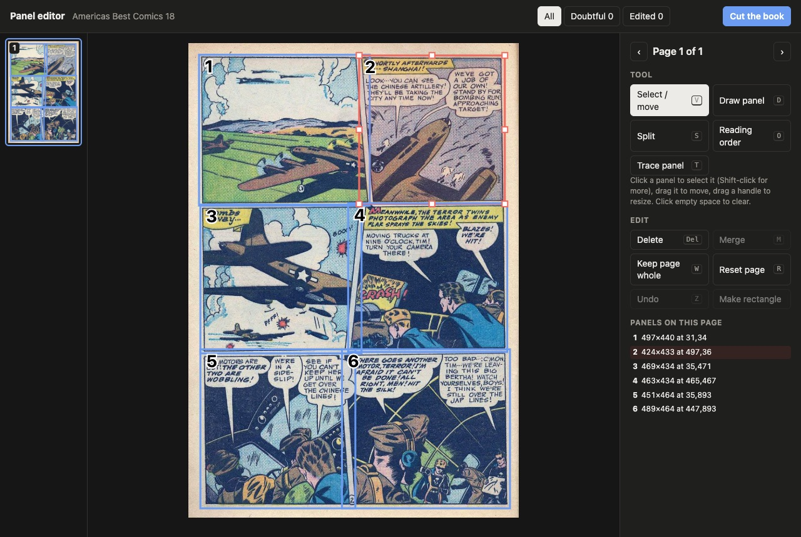

# ComicScissors

**Comic and manga panel splitter for e-readers**

ComicScissors cuts the panels out of each comic page and puts them on pages the size of your
e-reader screen. You read panel by panel, without zooming.

It runs as a command line tool on macOS, Windows and Linux, or as a Calibre plugin.


<sub>Sample page: *America's Best Comics* #18 (1946), "The Black Terror", art by Ed Moritz.
Public domain, via [Wikimedia Commons](https://commons.wikimedia.org/wiki/File:AmericasBestComics1804.jpg).</sub>

## Features

- **Input:** PDF, CBZ, CBR, CB7, DRM-free Kindle books (AZW3, MOBI), an image, or a folder of images.
- **Output:** PDF, EPUB, KEPUB, AZW3 or CBZ, sized for your e-reader.
- **Devices:** Kindle, Kobo, PocketBook, Boox, Tolino, reMarkable and Nook models are built in.
  Any other screen size works too.
- **Manga:** reads panels right to left.
- **Dictionary:** OCR adds the words of the speech balloons as invisible text, so you can look them up.
- **Final touch:** check and fix the panels in a panel editor before the book is cut.
- **Webtoons:** cuts vertical scroll comics between their panels.

## Final touch: the panel editor

Before the cut, you can check and fix the panels yourself. In Calibre, select **Final touch (open
panel editor)** in the pop-up. On the command line, use `--edit`.
The editor shows every page with its panels. Panels that the tool is not sure about are marked.



In the editor you can:

- move and resize a panel;
- draw a new panel, or delete one;
- merge panels, or split a panel along a line;
- click the panels in reading order;
- keep a page whole;
- trace a panel that is not a rectangle: click around its edge (key T).

Click **Cut the book** to cut the book with your panels. In Calibre, closing the editor window
also cuts the book.

ComicScissors keeps your fixes with the book. Later conversions, for any device or format, use the
same panels. Calibre keeps them as the data file `comicscissors_panels.json`. On the command line,
use `--keep-panels book.panels.json`.

To fix panels in two steps, `--detect-only panels.json` writes the panels to a file and stops.
`--panels panels.json` then cuts with that file.

## Install

### Calibre plugin

1. Download `comic-scissors-<version>-calibre-plugin.zip` from the
   [releases](https://github.com/rustsky/comicscissors/releases). It works on all platforms.
2. In Calibre, open *Preferences → Plugins → Load plugin from file* and select the zip.
3. Add the **Repack for e-reader** button to a toolbar.

The plugin includes the tool. Calibre supplies the PDF renderer, the CBR/CB7 unpacker and the
AZW3 converter.

### Command line

Download the archive for your platform from the
[releases](https://github.com/rustsky/comicscissors/releases), or build the tool:

```sh
cargo build --release      # the tool is target/release/comic-scissors
```

Some inputs and outputs need other tools:

| For | You need |
|---|---|
| PDF input | `mutool` (MuPDF) or `pdftoppm` (Poppler): `brew install mupdf` |
| CBR and CB7 input | `bsdtar` (part of macOS), `unar` or `7z` |
| AZW3 output | Calibre (`ebook-convert`) |
| Dictionary text | Tesseract: `brew install tesseract`, plus `brew install tesseract-lang` for languages other than English |

## Use with Calibre

1. Select one or more comics.
2. Click **Repack for e-reader**.
3. In the pop-up, select how to read the panels: left to right (comic) or right to left (manga).
   Books with the tag *Manga* start as manga.
4. Optional: select **Final touch (open panel editor)** to fix the panels before the cut
   (see [Final touch](#final-touch-the-panel-editor)).
5. Check the settings below: e-reader, output format, quality, language and more.
6. Click **Repack**.

Calibre adds the result to the book as a new format, for example a PDF next to the CBZ.
Use *Send to device* to copy it to your e-reader.

Calibre never replaces an original file. If the book already has an original file in the output
format (for example a CBZ repacked to CBZ), the result goes to a copy of the book. The copy has
the title *Title (repanel)*. You can change this suffix in the pop-up. A new repack replaces only
the earlier result.

## Use from the command line

```sh
comic-scissors mycomic.cbz                          # asks for your e-reader and the comic's language
comic-scissors mycomic.pdf -d paperwhite-5          # writes mycomic_repanel.pdf
comic-scissors manga.cbz -d oasis --rtl --lang ja   # manga, Japanese text
comic-scissors mycomic.cbz -d kobo-libra-colour -f kepub
comic-scissors mycomic.cbz -d paperwhite-5 --edit   # fix the panels in the editor first
comic-scissors pages/ -d kindle-11 -f cbz           # a folder of images
comic-scissors --list-devices
comic-scissors in.cbz --width 1072 --height 1448 --ppi 300   # a screen that is not in the list
```

Copy the result to the e-reader over USB. On a Kindle, put it in the `documents` folder.
Each page is exactly the size of the screen.

### Output formats

| Format | Use it for |
|---|---|
| `pdf` (default) | All e-readers. On a Kindle, dictionary lookup works only in PDF. |
| `epub` | Kobo, PocketBook, Tolino, Boox, Apple Books. Send to Kindle turns it into a Kindle book. |
| `kepub` | Kobo. Pages turn faster than in EPUB. |
| `azw3` | Kindle over USB. Shown full screen, with cover and reading progress. Needs Calibre. |
| `cbz` | Comic reader apps such as KOReader and Panels. |

EPUB and KEPUB are fixed-layout EPUB 3 books with one image per page.

## When the result is not right

| Problem | Try |
|---|---|
| Text is too small | `-s 1.0` or higher |
| Too few panels per page | `-s 0.65` |
| Wide panels are too small | `--rotate` (shows them in landscape on their own page) |
| Two panels stay together | `--split-coverage 0.5`, `--threshold 30` |
| One panel is cut into pieces | `--split-coverage 0.2` |
| A panel shape is cut badly | `--rect-crop` (crops each panel to its box) |
| E-ink looks washed out | `--gamma 1.4` |
| Paper or shading is too bright | `--no-auto-levels` |
| The file is too big | `-q 70`, `--max-upscale 1.3` |
| Dictionary lookup misses words | Check `--lang`. Copy the PDF over USB: Send to Kindle can remove the text. |
| Detection does not suit the book | `--style` and `--substyle` (see below) |

To see what the tool detected, use `--debug-dir dbg/`. It writes each page with its panels,
numbered in reading order (`3?` means doubtful), and `report.txt` with the reasons. A review page
then opens in the browser. There you can tag the pages that are wrong.

## How it works

1. **Book style.** A quick pass measures the book: gutters, bleeds, colour, paper and page shape.
   It selects a style: `manga`, `western-modern`, `western-classic`, `bande-dessinee` or
   `newspaper-strip`. Substyles such as `color`, `hairline`, `bleed` and `dense` adjust it.
2. **Panels.** The tool finds the gutters: the paper between the panels. Each area of art
   between them is a panel. Frame lines help to tell panels from art. A panel that a speech
   balloon joins to its neighbour is cut along the gutter.
3. **Page pattern.** Each page gets a pattern, for example a grid, a T column, an L shape, an
   inset or a splash. The pattern adjusts the settings for that page.
4. **Second look.** Each panel gets a confidence score. The tool searches doubtful panels again at
   full resolution. Panels that stay doubtful are marked in the editor and the report.
5. **Reading order.** Rows from top to bottom. In a row, left to right, or right to left for manga.
6. **Layout.** Each panel shows at least 0.8 times its printed size (`-s`). As many panels as fit
   go on each e-reader page, then they are scaled up to fill it.
7. **Text.** Tesseract reads the speech balloons. Each word goes as invisible text exactly over its
   letters, so a long press selects it. `--no-ocr` turns this off. OCR adds about 1 second per page
   per CPU core.
8. **Output.** The first page stays whole as the cover. Auto contrast makes the paper white and the
   ink black. Chapters (subfolders) become bookmarks.

## Known limitations

- The tool cannot split panels that have no gutter between them. It marks them as doubtful.
- It can miss a gutter that the art crosses.
- When a balloon crosses a slanted gutter, the last letters can go with the next panel.
- On a Kindle, dictionary lookup works in PDF only. The Kindle ignores the text in AZW3 comics.

## For developers

- **Tests.** Detection bugs are tested on synthetic pages (`src/synth.rs`) that copy the failing
  page layouts with plain shapes. Real pages cannot go in the repository.
  `scripts/synthetic_pages.sh` writes them as PNG files to `target/synthetic/`.
- **Releases.** Change `version` in `Cargo.toml`, commit, then run
  `git tag v<version> && git push --tags`. CI builds the archives and the plugin zip, and
  publishes the release.
- **Local archive.**
  `python3 scripts/package.py --binary target/release/comic-scissors --platform macos-arm64`
  writes it to `dist/`.
