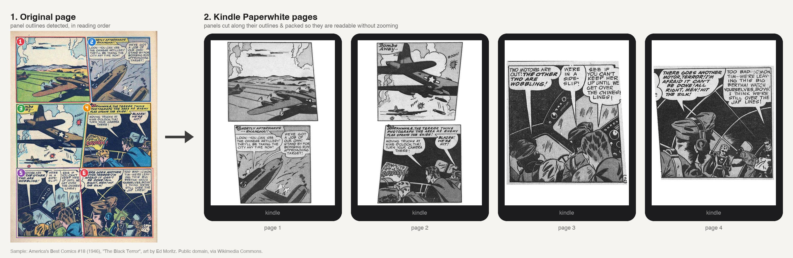

# ComicScissors

**Comic & manga panel splitter for e-readers**

Read comics and manga on a Kindle or any other e-reader panel by panel, without zooming.
ComicScissors detects the panels on each page of a PDF, CBZ, CBR or CB7, cuts them out and
repacks them onto pages sized for your device: Kindle, Kobo, PocketBook, Boox, Tolino,
reMarkable and Nook models are built in, and any other screen size works too. The result is a
PDF, EPUB, KEPUB, AZW3 or CBZ.
It runs as a command line tool on macOS, Windows and Linux, or as a Calibre plugin.



<sub>Sample page: *America's Best Comics* #18 (1946), "The Black Terror", art by Ed Moritz.
Public domain, via [Wikimedia Commons](https://commons.wikimedia.org/wiki/File:AmericasBestComics1804.jpg).</sub>

## Build

```sh
cargo build --release
# binary: target/release/comic-scissors
```

PDF input needs `mutool` (MuPDF) or `pdftoppm` (Poppler) on PATH (`brew install mupdf`).
CBR/CB7 input uses `bsdtar` (built into macOS), `unar` or `7z`.
The dictionary text layer needs Tesseract (`brew install tesseract`). English is included; for
other languages, run `brew install tesseract-lang`.

## Calibre plugin

Each [release](https://github.com/rustsky/comicscissors/releases) has one archive per platform
(`linux-x86_64`, `macos-universal`, `windows-x86_64`) that holds the `comic-scissors` CLI and
`comic-scissors-calibre-plugin.zip`. The plugin includes the same binary.
`comic-scissors-<version>-calibre-plugin.zip` is the plugin for all three platforms: it holds every
binary and picks the right one when it first runs.

Install it with *Preferences → Plugins → Load plugin from file*, then add the **Repack for e-reader**
button to a toolbar. Select comics (CBZ, CBR, CB7 or PDF) and click it. The result is added to
the same book as a new format (e.g. a CBZ book gets a PDF), so it can be sent to the e-reader with
*Send to device*. An original file is never replaced: when the book already has an original file
of the output type (a PDF comic repacked to PDF), the result is saved as the data file
`data/Title - Author_repanel.pdf` instead, shown under *Data files* in Book details. Repacking
again replaces only the earlier result.
Use the button's menu → *Settings* to choose the e-reader (or a custom screen size), the output format, the image quality, the language, manga mode, full-page overviews, webtoon mode, the cover page, auto contrast and extra CLI flags. The book's title and authors from the library go into the output's metadata.

PDFs are rendered with the Poppler tools bundled in Calibre, and CBR/CB7 files are unpacked by
Calibre, and AZW3 is made with Calibre's own `ebook-convert`, so nothing else needs to be installed. The text layer still needs Tesseract. Without it,
the plugin converts without the text layer.

Releases: bump `version` in `Cargo.toml`, commit, then `git tag v<version> && git push --tags`.
CI builds the three archives and the all-platform plugin zip, and publishes the release. To build
an archive locally:

```sh
cargo build --release
python3 scripts/package.py --binary target/release/comic-scissors --platform macos-arm64   # -> dist/
```

Detection regressions are tested on synthetic pages (`src/synth.rs`) that redraw the failing book
pages with plain shapes, since real pages can't go into the repository. `scripts/synthetic_pages.sh`
writes them out as PNGs, each with a copy showing the detected panels, to `target/synthetic/`.

## Use

```sh
comic-scissors mycomic.cbz                       # asks which e-reader you have and the comic's language
comic-scissors mycomic.pdf -d paperwhite-5       # -> mycomic_repanel.pdf
comic-scissors pages/ -d kindle-11 -f cbz        # folder of images -> CBZ
comic-scissors mycomic.cbz -d kobo-libra-colour -f kepub   # -> mycomic_repanel.kepub.epub
comic-scissors mycomic.cbz -d paperwhite-5 -f azw3        # Kindle book (needs calibre)
comic-scissors manga.cbz -d oasis --rtl --print-height 7.2 --lang ja
comic-scissors mycomic.cbz -d kindle-11 --overview  # each full page, then its panels
comic-scissors vol1.cbz -d oasis --title "Vol. 1" --author "Jane Doe"   # metadata
comic-scissors episodes.cbz -d kobo-libra-colour --webtoon   # vertical scroll comic
comic-scissors bd.cbz -d paperwhite-5 --lang fr       # French text layer
comic-scissors mycomic.cbr -d kobo-libra-colour  # Kobo, PocketBook, Boox, Tolino, reMarkable, Nook
comic-scissors --list-devices
comic-scissors in.cbz --width 1072 --height 1448 --ppi 300   # custom screen
```

Copy the output to the e-reader over USB (on a Kindle, into its `documents` folder).
Each page is exactly the size of the screen.

| Format | Best for |
|---|---|
| `pdf` (default) | every e-reader; the only format with the dictionary text layer |
| `epub` | Kobo, PocketBook, Tolino, Boox, Apple Books; Send to Kindle turns it into a Kindle book |
| `kepub` | Kobo (faster page turns than EPUB) |
| `azw3` | Kindle over USB: shown full screen as a comic, with cover and reading progress |
| `cbz` | comic reader apps (KOReader, Panels, ...) |

EPUB and KEPUB are fixed-layout EPUB 3 (one image per page, right-to-left page turns with
`--rtl`). AZW3 is converted from that EPUB with calibre's `ebook-convert`, which must be
installed (it is found on PATH or in calibre's default install folder).

## How it works

1. **Input**: PDF pages are rendered at `--pdf-dpi`. Archives are extracted, and images are
   sorted in natural order (`p2` comes before `p10`).
2. **Panel detection**: the paper colour is the median of the page edge. Everything that differs
   from it by more than `--threshold` counts as ink. Paper reachable from the page edge, plus thin,
   long strips of paper, form the gutters. Everything else becomes a solid blob, with each panel's
   interior filled in. Each blob is one panel candidate. When a speech balloon crosses a gutter and
   joins two panels, the blob is cut along lines that are mostly empty (`--split-coverage`). Panels
   are then put in reading order: rows top to bottom, then left to right, or right to left with
   `--rtl`. Small regions such as page numbers are dropped.

   **Confidence and second round.** Every panel gets a confidence score built from
   simple checks: a notched outline, a cut at a speech balloon, a paper-coloured gutter-like
   line inside it, little drawn border, tiny or sliver-shaped, or 1.5×/2.5× bigger than the
   book's median panel. Doubtful panels get a second, stricter search at full resolution
   for a straight gutter at any angle within ±12° of horizontal or vertical. A gutter counts
   only if the line is at least 90% paper with a dark border line close by on *both* sides,
   so caption boxes and horizons are not cut. If no gutter is found, the "gutter inside" and
   "bigger than usual" doubts are cleared. Small doubtful fragments (title lettering) are
   merged into the nearest panel, and slivers along the page edge (scan debris) are dropped.
   Panels that stay doubtful are listed for review. `--no-refine` skips this round.

   Each panel keeps its outline (the convex hull of its blob), so slanted and irregular panels
   are cut out exactly and slivers of neighbouring panels are painted white. Use `--rect-crop`
   to crop plain bounding boxes instead.
   **Webtoons** (`--webtoon`, chosen automatically when pages are over 3× taller than wide):
   vertical-scroll comics have no pages or gutter grid. Consecutive images of the same width
   (the slices an episode is saved as) are joined into one strip, and the strip is cut at
   bands of plain background at least 1/50 of its width tall: the space between panels, in
   any colour. Captions and balloons floating between panels stay with the strip in order.
   Each piece is shown at the screen's width, and one taller than the screen is split at its
   quietest row. Each subfolder (episode) gets its own bookmark.
3. **Layout**: each panel must appear at least `--readable-scale` (default 0.8) times its printed
   size. The tool works this out from the device ppi and `--print-height`. Panels from the same
   row stay side by side when they fit. Otherwise they are stacked. Each e-reader page is filled
   with as many panels as fit, and then scaled up to use any leftover space. With `--overview`, each
   original page is first shown whole on its own page, then its panels follow.
4. **Text layer** (PDF only): each page is OCR'd with Tesseract, and every recognised word is
   placed as invisible text exactly over its lettering, following the panel's crop, scale and
   rotation. Long-pressing a word on the Kindle then selects it for dictionary lookup,
   highlighting and search. ALL-CAPS lettering is stored in lowercase, and words hyphenated
   across lines are joined, so lookups find dictionary entries. The language is set with
   `--lang` (default `en`), and `--no-ocr` turns this off. OCR adds about 1 s per page per
   CPU core. Sound effects and stylised lettering are mostly not recognised.
5. **Output**: grayscale JPEG pages (colour on Colorsoft or with `--color`), saved as PDF, EPUB,
   KEPUB, AZW3, CBZ or an image folder.
   - **Cover**: the first page is kept whole, not split, so the e-reader's library shows it as
     the cover (`--no-cover` splits it like the others).
   - **Auto contrast**: each page is stretched so its paper (the median of the page edge)
     becomes white and its darkest 1% black. Pages with dark borders or little contrast are
     left alone. `--no-auto-levels` turns it off.
   - **Bookmarks**: the PDF outline and the EPUB/AZW3 table of contents have one entry per
     chapter when the archive or folder has a subfolder per chapter, otherwise one per page.
   - **Metadata**: `--title` (default: the file name) and `--author`.

## Tuning

| Problem | Try |
|---|---|
| Text still too small | `-s 1.0` (or higher) |
| Too few panels per page | `-s 0.65` |
| Wide panels too small | `--rotate` (puts them in landscape on their own page) |
| Panels merged together | `--split-coverage 0.5`, `--threshold 30` |
| Panels split too much | `--split-coverage 0.2` |
| Washed-out e-ink | `--gamma 1.4` (after auto contrast) |
| Paper or shading looks too bright | `--no-auto-levels` |
| File too big | `-q 70` (JPEG quality, default 88), `--max-upscale 1.3` |
| Dictionary lookup missing words | check `--lang`; copy the PDF over USB (Send to Kindle can drop the text layer) |
| Neighbouring panels cut into an L-shaped panel | `--rect-crop` |
| Drawing style | Settings come in three layers. A quick pass measures the book (gutter widths, how many pages bleed off the edge, colour, paper, page shape) and picks its style: `manga`, `western-modern`, `western-classic`, `bande-dessinee` or `vintage` (`--style` forces one). Its substyles adjust that: `color`, `hairline` (hairline gutters), `bleed` (panels running off the page), `dense` (narrow gutters); `--substyle hairline,bleed` forces them. Each page then gets a pattern (grid, T column, L shape, inset, splash) whose preset adjusts the settings for that page; neighbouring panels with no frame line or gutter between them are merged, and an L-shaped panel is cut out around its inset. All are printed while converting and listed per page in `--debug-dir`'s `report.txt` |
| Check detection | `--debug-dir dbg/` writes each page with the detected panel outlines, numbered in reading order (`3?` = still doubtful), plus `report.txt` with each panel's confidence and the reasons. After the book is written it opens a review page in the browser: tag the pages detected wrong (what went wrong, a note, and optionally the boxes of the panels that should have been found). Tags go to `dbg/review.json` and the original of each tagged page to `dbg/sources/`. `--no-review` skips it |

## Known limitations

- Panels merged **without any gutter** (art or balloons run straight from one panel into the
  next) can't be split; they're reported as doubtful (`much bigger than usual`).
- A gutter crossed by artwork, not only by balloons, can be missed.
- A balloon that crosses a slanted gutter is cut along the gutter, so its last letters can end
  up with the neighbouring panel.
